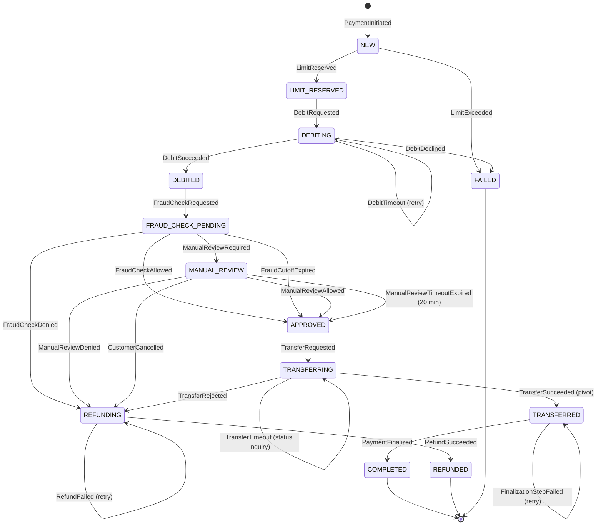

# Задание 2. State Machine платёжной операции

Состояние платежа хранится в PostgreSQL (таблица `payment`, поля `status`, `reason`, `approved_by_cutoff`, `version`). Оно меняется только оркестратором Saga, атомарно вместе с записью события в журнал `payment_state_log` (кто, когда, из какого состояния, по какому событию). По журналу бизнес и служба безопасности видят, на каком шаге транзакция находится или «зависла».

## Состояния

| Состояние | Смысл | Деньги клиента | Финальное |
|---|---|---|---|
| `NEW` | Платёж создан, Saga запущена | на счёте клиента | нет |
| `LIMIT_RESERVED` | Лимит зарезервирован | на счёте клиента | нет |
| `DEBITING` | Отправлен запрос на списание, ждём ответ | не определено (выясняется запросом статуса) | нет |
| `DEBITED` | Деньги списаны на транзитный счёт | на транзитном счёте | нет |
| `FRAUD_CHECK_PENDING` | Ждём ответ антифрода, запущен таймер cut-off | на транзитном счёте | нет |
| `MANUAL_REVIEW` | Транзакция у оператора, запущен таймер 20 минут | на транзитном счёте | нет |
| `APPROVED` | Проверки пройдены (или разрешено по cut-off) | на транзитном счёте | нет |
| `TRANSFERRING` | Отправлен перевод контрагенту, ждём ответ (pivot) | не определено (выясняется запросом статуса) | нет |
| `TRANSFERRED` | Деньги у контрагента, pivot-точка пройдена | у контрагента | нет |
| `COMPLETED` | Платёж проведён, учёт и уведомления выполнены | у контрагента | да |
| `REFUNDING` | Идёт компенсация: возврат денег клиенту | на транзитном счёте → клиенту | нет |
| `REFUNDED` | Деньги возвращены клиенту, причина в `reason` (`FRAUD`, `TECHNICAL`, `CUSTOMER_CANCEL`) | на счёте клиента | да |
| `FAILED` | Платёж не выполнен, деньги не списывались | на счёте клиента | да |

## Таблица переходов

| Исходное состояние | Переходное состояние | Событие |
|---|---|---|
| — | `NEW` | `PaymentInitiated`: клиент оформил заказ и инициировал платёж (`CREATE_PAYMENT`) |
| `NEW` | `LIMIT_RESERVED` | `LimitReserved`: лимит проверен и зарезервирован (`RESERVE_LIMIT`) |
| `NEW` | `FAILED` | `LimitExceeded`: лимит превышен (`CANCEL_PAYMENT`, `NOTIFY_CUSTOMER_FAILURE`) |
| `LIMIT_RESERVED` | `DEBITING` | `DebitRequested`: оркестратор отправил запрос на списание (`DEBIT_FUNDS`) |
| `DEBITING` | `DEBITED` | `DebitSucceeded`: деньги списаны на транзитный счёт |
| `DEBITING` | `DEBITING` | `DebitTimeout`: ответ не получен, оркестратор запрашивает статус и повторяет с тем же ключом идемпотентности |
| `DEBITING` | `FAILED` | `DebitDeclined`: недостаточно средств или счёт заблокирован (`RELEASE_LIMIT`, `CANCEL_PAYMENT`, `NOTIFY_CUSTOMER_FAILURE`) |
| `DEBITED` | `FRAUD_CHECK_PENDING` | `FraudCheckRequested`: запрос в FraudCheck отправлен, запущен таймер cut-off |
| `FRAUD_CHECK_PENDING` | `APPROVED` | `FraudCheckAllowed`: антифрод вернул «Разрешение» |
| `FRAUD_CHECK_PENDING` | `REFUNDING` | `FraudCheckDenied`: антифрод вернул «Запрет» (`reason = FRAUD`, параллельно `NOTIFY_SECURITY`) |
| `FRAUD_CHECK_PENDING` | `MANUAL_REVIEW` | `ManualReviewRequired`: антифрод вернул «Ручная проверка», запущен таймер 20 минут |
| `FRAUD_CHECK_PENDING` | `APPROVED` | `FraudCutoffExpired`: ответа нет до cut-off-time, транзакция разрешена по умолчанию (`approved_by_cutoff = true`, ставится пост-фактум проверка) |
| `MANUAL_REVIEW` | `APPROVED` | `ManualReviewAllowed`: оператор разрешил транзакцию |
| `MANUAL_REVIEW` | `REFUNDING` | `ManualReviewDenied`: оператор запретил транзакцию (`reason = FRAUD`, параллельно `NOTIFY_SECURITY`) |
| `MANUAL_REVIEW` | `APPROVED` | `ManualReviewTimeoutExpired`: оператор не принял решение за 20 минут, транзакция разрешена по cut-off (`approved_by_cutoff = true`) |
| `MANUAL_REVIEW` | `REFUNDING` | `CustomerCancelled`: клиент отменил платёж во время ручной проверки (`CANCEL_FRAUD_CHECK`, `reason = CUSTOMER_CANCEL`) |
| `APPROVED` | `TRANSFERRING` | `TransferRequested`: оркестратор отправил перевод контрагенту (`TRANSFER_TO_COUNTERPARTY`) |
| `TRANSFERRING` | `TRANSFERRED` | `TransferSucceeded`: деньги зачислены контрагенту, pivot-точка пройдена |
| `TRANSFERRING` | `TRANSFERRING` | `TransferTimeout`: результат неизвестен, оркестратор запрашивает статус и повторяет с тем же ключом (компенсация до выяснения статуса запрещена) |
| `TRANSFERRING` | `REFUNDING` | `TransferRejected`: окончательный отказ банка или шлюза (`reason = TECHNICAL`) |
| `TRANSFERRED` | `COMPLETED` | `PaymentFinalized`: выполнены `COMPLETE_PAYMENT`, `POST_TO_LEDGER`, `NOTIFY_CUSTOMER_SUCCESS` |
| `TRANSFERRED` | `TRANSFERRED` | `FinalizationStepFailed`: шаг после pivot не выполнился, повтор до успеха |
| `REFUNDING` | `REFUNDED` | `RefundSucceeded`: деньги возвращены, выполнены `RELEASE_LIMIT`, `CANCEL_PAYMENT`, `NOTIFY_CUSTOMER_FAILURE` |
| `REFUNDING` | `REFUNDING` | `RefundFailed`: возврат не прошёл, повтор с экспоненциальной задержкой. После N попыток алерт DevOps/SRE, без ручной обработки поддержкой |

Поздние события, пришедшие после выхода из состояния ожидания, не меняют состояние, а только пишутся в журнал. Например, ответ антифрода после cut-off или решение оператора после таймера.

- Поздний `DENY` после разрешения по cut-off передаётся в процесс пост-фактум возврата.
- Дубли сообщений отсекаются по `messageId`.

## Ключевые сценарии

| Сценарий | Путь по состояниям |
|---|---|
| Антифрод разрешил | `NEW → LIMIT_RESERVED → DEBITING → DEBITED → FRAUD_CHECK_PENDING → APPROVED → TRANSFERRING → TRANSFERRED → COMPLETED` |
| Антифрод отказал | `… → FRAUD_CHECK_PENDING → REFUNDING → REFUNDED (FRAUD)` |
| Сработал cut-off | `… → FRAUD_CHECK_PENDING → APPROVED (approved_by_cutoff) → TRANSFERRING → TRANSFERRED → COMPLETED` |
| Ручная проверка, разрешение | `… → FRAUD_CHECK_PENDING → MANUAL_REVIEW → APPROVED → … → COMPLETED` |
| Ручная проверка, запрет | `… → FRAUD_CHECK_PENDING → MANUAL_REVIEW → REFUNDING → REFUNDED (FRAUD)` |
| Ручная проверка, оператор не успел за 20 минут | `… → MANUAL_REVIEW → APPROVED (approved_by_cutoff) → … → COMPLETED` |
| Недостаточно средств | `NEW → LIMIT_RESERVED → DEBITING → FAILED` |
| Отказ перевода контрагенту | `… → APPROVED → TRANSFERRING → REFUNDING → REFUNDED (TECHNICAL)` |

## Диаграмма состояний

