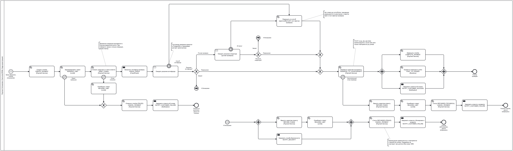

# Задание 4. BPMN-процесс обработки платежа

- `payment-saga.png` — диаграмма-картинка (артефакт для сдачи).
- `payment-saga.bpmn` — исходник BPMN 2.0 с DI-разметкой. Открывается в Camunda Modeler или на bpmn.io и служит основой для реализации оркестрации в BPM-движке.

## Как читать схему

Весь процесс исполняет один пул — **Payment Orchestrator** (Camunda). В квадратных скобках у задач указан сервис, который вызывает оркестратор. Коды шагов совпадают с реестром транзакций (Task1).

1. **Компенсируемые шаги.** `CREATE_PAYMENT` → `RESERVE_LIMIT` → `DEBIT_FUNDS` → `FRAUD_CHECK`.
   - Ошибки бизнес-уровня («Лимит превышен», «Отказ списания») ловятся граничными error-событиями.
   - После них идут компенсации: `RELEASE_LIMIT`, `CANCEL_PAYMENT (FAILED)` и уведомление клиента.
2. **Антифрод.** Запрос отправляется send-задачей, ответ ждёт receive-задача «Ожидать решение антифрода» (состояние ожидания хранится в PostgreSQL). Шлюз «Решение антифрода?» разводит три ответа:
   - **Разрешение** — к переводу контрагенту;
   - **Ручная проверка** — receive-задача «Ожидать решение оператора» с граничным таймером **20 минут**;
   - **Запрет** — link-событие «К блокировке».
3. **Cut-off.** Граничные таймеры на обоих ожиданиях (cut-off антифрода и 20 минут ручной проверки) ведут в задачу «Разрешить по cut-off». Она ставит флаг `approvedByCutoff` и запускает пост-фактум проверку, после чего транзакция идёт дальше как разрешённая.
4. **Блокировка (автоматический возврат при фроде).** Link-событие «К блокировке» запускает ветку:
   - параллельно выполняются мгновенный возврат (`REFUND_FUNDS` → `RELEASE_LIMIT`) и уведомление службы безопасности (`NOTIFY_SECURITY`);
   - затем `CANCEL_PAYMENT (REFUNDED, FRAUD)` и уведомление клиента.
5. **Pivot-точка** — `TRANSFER_TO_COUNTERPARTY`.
   - При окончательном отказе банка граничное событие «Окончательный отказ перевода» запускает автоматический возврат (`REFUND_FUNDS` → `RELEASE_LIMIT` → `CANCEL_PAYMENT (REFUNDED, TECHNICAL)` → уведомление).
   - При таймауте вызова воркер запрашивает статус операции и повторяет вызов с тем же ключом. Возврат запускается только при подтверждённом отказе.
6. **После pivot-точки** параллельно выполняются повторяемые шаги: `COMPLETE_PAYMENT`, `POST_TO_LEDGER` (Финансы), `NOTIFY_CUSTOMER_SUCCESS`. Технические сбои в них не компенсируются: движок повторяет шаги (retry с backoff, инцидент в Cockpit или Operate при исчерпании попыток).

Технические сбои (таймауты, 5xx) на всех шагах обрабатываются ретраями воркеров с ключом идемпотентности. Граничные error-события используются только для окончательных бизнес-отказов.
